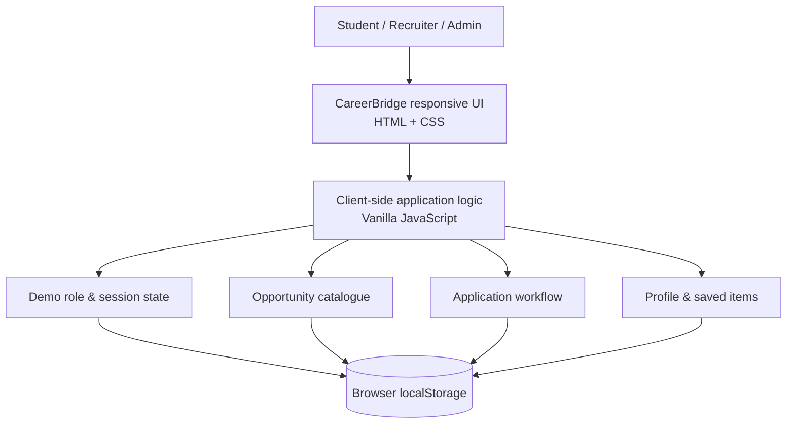

# System Architecture & Technology Stack

## Prototype architecture

## Stack

| Layer | Technology | Purpose |
|---|---|---|
| Presentation | HTML5 | Semantic page structure and forms |
| Styling | CSS3 | Responsive layout, components and visual system |
| Client logic | Vanilla JavaScript | Navigation, filters, validation, role views and CRUD |
| Prototype persistence | Browser localStorage | Store demo profiles, listings, applications, saved items and notifications |
| Production-ready future option | React + FastAPI + PostgreSQL | Component-based frontend, API service and relational persistence |

## Request / data flow

1. User opens `index.html`; the app loads the seeded prototype database from localStorage (or initializes it with sample records).
2. User action invokes a client-side handler.
3. Handler validates required fields and updates the in-memory data object.
4. `save()` serializes the updated object to localStorage.
5. `render()` refreshes the relevant view from the updated state.

## Role boundaries in the demo

- Student: browse, save and apply; update own profile; view own applications and notifications.
- Recruiter: create, update and remove opportunity listings.
- Admin: view the platform management workspace and manage listings.

These boundaries are UI demonstrations only. Production must enforce authorization on the server for every protected operation.
