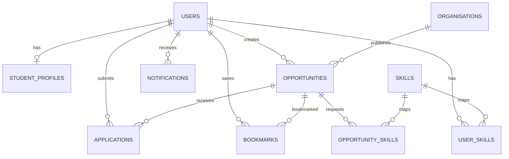

# Database Design (Proposed Production Schema)

The running prototype uses a single localStorage object for portability. The following relational schema is the recommended persistent design for a production implementation.

| Table | Fields (type) | Purpose / relationships |
|---|---|---|
| users | id UUID PK, full_name VARCHAR, email VARCHAR UNIQUE, password_hash TEXT, role ENUM, created_at TIMESTAMP | Principal accounts: student, recruiter, admin |
| student_profiles | user_id UUID PK/FK, college VARCHAR, degree VARCHAR, study_year SMALLINT, bio TEXT, resume_url TEXT | One profile per student; references users.id |
| skills | id UUID PK, name VARCHAR UNIQUE | Normalized skill catalogue |
| user_skills | user_id UUID FK, skill_id UUID FK, proficiency VARCHAR, composite PK | Many-to-many student skills |
| organisations | id UUID PK, name VARCHAR, website TEXT, verified BOOLEAN | Recruiter organisations |
| opportunities | id UUID PK, organisation_id UUID FK, created_by UUID FK, title VARCHAR, description TEXT, type ENUM, mode ENUM, location VARCHAR, stipend VARCHAR, duration VARCHAR, deadline DATE, status ENUM, created_at TIMESTAMP, updated_at TIMESTAMP | Internship, hackathon, event or course listing |
| opportunity_skills | opportunity_id UUID FK, skill_id UUID FK, composite PK | Skills requested by listing |
| applications | id UUID PK, student_id UUID FK, opportunity_id UUID FK, resume_url TEXT, cover_note TEXT, status ENUM, applied_at TIMESTAMP, updated_at TIMESTAMP, UNIQUE(student_id, opportunity_id) | Student applications and status tracking |
| bookmarks | student_id UUID FK, opportunity_id UUID FK, created_at TIMESTAMP, composite PK | Saved opportunities |
| notifications | id UUID PK, user_id UUID FK, title VARCHAR, body TEXT, read_at TIMESTAMP NULL, created_at TIMESTAMP | In-app notification feed |

## Entity relationships

## Data rules

- Email is unique and normalized to lowercase.
- One student can apply to a particular opportunity only once.
- Deadline must be on or after the publish date.
- Only recruiters/admins may create or edit listings; only admins may verify organisations.
- Application status is constrained to `Submitted`, `Under review`, `Shortlisted`, `Selected`, or `Rejected`.
- Passwords must be stored as strong salted hashes; never store plaintext passwords.
